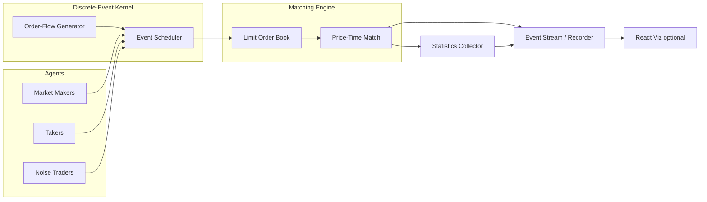
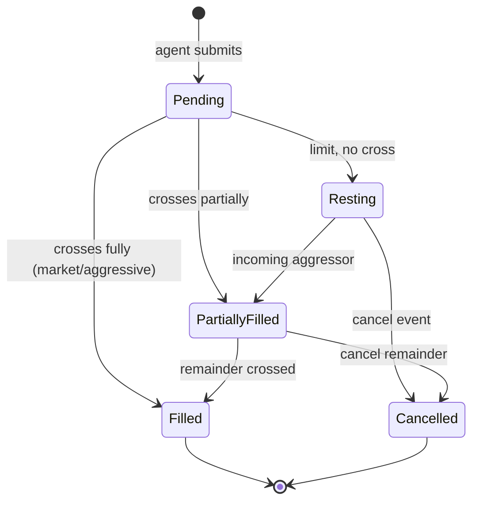

# Market Microstructure Simulator — Project Plan

An agent-based **market microstructure** simulator that builds a limit order book
from synthetic order flow and reproduces the emergent phenomena real markets
show: a fluctuating **bid–ask spread**, **liquidity depth**, **order
cancellations**, **price impact**, and clustered **volatility**. Agents (market
makers, takers, noise traders) interact through a price–time-priority matching
engine, letting you study *how mechanics produce prices* — not just the prices
themselves.

> **Note:** A C++ `limit-order-book` engine already exists in this workspace.
> This project can either reuse it via bindings or ship its own matching core;
> see §3 and §12.

---

## 1. Goals & Scope

| Goal | Description |
|------|-------------|
| Mechanistic | Model the *process* (arrivals, cancels, matches), not a price path directly. |
| Realistic | Reproduce stylized facts: fat-tailed returns, volatility clustering, mean-reverting spread. |
| Configurable | Tune agent populations, arrival rates, and impact parameters from config. |
| Observable | Stream every book event so dynamics can be visualized and measured. |

**Out of scope (v1):** real market data calibration to a specific name, multiple
venues / fragmentation, latency arbitrage between colocated agents, options or
multi-asset interactions.

---

## 2. Architecture



**Pattern:** A **discrete-event simulation** kernel advances a priority queue of
timestamped actions. Agents submit limit/market/cancel orders; the **matching
engine** enforces price–time priority and emits trades and book deltas; a
**statistics collector** computes microstructure metrics; an event stream feeds
an optional visualization.

---

## 3. Tech Stack

| Layer | Choice | Purpose |
|-------|--------|---------|
| Core engine | C++17 (hot path) **or** Python | Matching + simulation kernel |
| Bindings | pybind11 | Drive C++ core from Python experiments |
| Experiment layer | Python 3.11 | Configs, batch runs, analysis |
| Numerics | NumPy, SciPy, pandas | RNG, distributions, stats |
| Stochastics | custom Poisson/Hawkes samplers | Order-arrival processes |
| Config | Pydantic / YAML | Reproducible scenario files |
| Streaming | JSON Lines / Arrow / WebSocket | Event capture + live viz |
| Frontend (optional) | React (Vite + TS) + Plotly/D3 | Animated book + metric charts |
| Testing | pytest, Catch2 (if C++) | Engine + statistical tests |
| Tooling | ruff/black/mypy, clang-format | Lint, format, types |

> **Reuse option:** bind the existing `limit-order-book/` C++ engine via pybind11
> instead of writing a new matcher, and layer the agent/flow model on top.

---

## 4. Repository Structure

```
market-microstructure-simulator/
├── PLAN.md                       # this file
├── README.md
├── engine/                       # optional C++ core
│   ├── CMakeLists.txt
│   ├── include/mms/
│   │   ├── order_book.hpp
│   │   ├── matching.hpp
│   │   └── types.hpp
│   └── bindings/pybind_module.cpp
├── sim/                          # Python simulation package
│   ├── pyproject.toml
│   ├── mms/
│   │   ├── kernel.py             # discrete-event scheduler
│   │   ├── book.py               # LOB (or pybind wrapper)
│   │   ├── matching.py           # price-time priority
│   │   ├── orders.py             # order/cancel data types
│   │   ├── flow/                 # PURE stochastic generators
│   │   │   ├── poisson.py
│   │   │   ├── hawkes.py
│   │   │   └── size_dist.py
│   │   ├── agents/               # behavior models
│   │   │   ├── base.py
│   │   │   ├── market_maker.py
│   │   │   ├── taker.py
│   │   │   └── noise.py
│   │   ├── impact.py             # price-impact models
│   │   ├── metrics.py            # spread, depth, volatility, impact
│   │   └── recorder.py           # event stream → JSONL/Arrow
│   ├── scenarios/                # YAML configs
│   │   ├── balanced.yaml
│   │   ├── thin_liquidity.yaml
│   │   └── toxic_flow.yaml
│   └── tests/
│       ├── test_matching.py
│       ├── test_flow.py
│       ├── test_agents.py
│       ├── test_impact.py
│       └── test_stylized_facts.py
└── frontend/                     # optional viz
    ├── package.json
    └── src/
        ├── App.tsx
        ├── components/
        │   ├── BookHeatmap.tsx
        │   ├── PriceTape.tsx
        │   ├── SpreadChart.tsx
        │   └── DepthChart.tsx
        └── api/stream.ts
```

---

## 5. Order Lifecycle & Matching



Matching follows strict **price–time priority**: best price first, FIFO within a
price level. Market orders sweep levels until filled or the book is exhausted.

---

## 6. The Math (Models)

### 6.1 Order-flow as point processes

Limit orders, market orders, and cancellations arrive as independent **Poisson
processes** with intensities $\lambda_L, \lambda_M, \lambda_C$ (the Smith–Farmer
"zero-intelligence" baseline):

$$P(\text{$k$ events in } \Delta t) = \frac{(\lambda \Delta t)^k e^{-\lambda \Delta t}}{k!}$$

Cancellation of each resting order is exponential with rate $\mu$, so an order's
lifetime $\sim \text{Exp}(\mu)$.

### 6.2 Self-exciting arrivals (Hawkes)

To produce **clustered** activity and volatility, optionally drive arrivals with
a Hawkes process whose intensity jumps after each event and decays:

$$\lambda(t) = \mu_0 + \sum_{t_i < t} \alpha\, e^{-\beta (t - t_i)}$$

Branching ratio $n = \alpha/\beta < 1$ ensures stationarity; larger $n$ ⇒ burstier
flow and fatter-tailed returns.

### 6.3 Limit-price placement

Relative limit prices (ticks from the opposite best) are drawn from a
heavy-tailed distribution (e.g. power law / log-normal), so liquidity is dense
near the touch and sparse in the tail — matching observed book shapes.

### 6.4 Order sizes

Sizes drawn from a log-normal or power-law distribution:

$$\ln q \sim \mathcal{N}(\mu_q, \sigma_q^2)$$

### 6.5 Reference prices

- **Mid-price:** $\displaystyle m = \tfrac{1}{2}(P^{\text{bid}}_{\text{best}} + P^{\text{ask}}_{\text{best}})$
- **Microprice** (size-weighted, a better short-horizon predictor):

$$p_{\text{micro}} = \frac{Q^{\text{ask}} P^{\text{bid}} + Q^{\text{bid}} P^{\text{ask}}}{Q^{\text{bid}} + Q^{\text{ask}}}$$

### 6.6 Spread & depth

$$\text{spread} = P^{\text{ask}}_{\text{best}} - P^{\text{bid}}_{\text{best}}, \qquad
\text{depth}_D = \sum_{k=1}^{D} q_k^{\text{bid}} + q_k^{\text{ask}}$$

### 6.7 Price impact

- **Linear (Kyle's $\lambda$):** signed order flow moves price linearly,
  $\Delta p = \lambda\, x$, where $x$ is signed volume and $\lambda$ measures
  illiquidity.
- **Square-root law (empirical):** the impact of executing volume $Q$ scales as

$$\Delta p \;\propto\; Y\,\sigma \sqrt{\frac{Q}{V}}$$

with daily volatility $\sigma$ and traded volume $V$. The simulator *measures*
realized impact from sweeps and compares it to these models.

### 6.8 Market-maker quoting

Inventory-aware maker à la Avellaneda–Stoikov: a reservation price shifted by
inventory $q$ and risk aversion $\gamma$, then symmetric quotes of half-spread
$\delta$:

$$r = m - q\,\gamma \sigma^2 (T - t), \qquad
\text{bid} = r - \delta,\;\; \text{ask} = r + \delta$$

Makers widen quotes and skew to offload inventory; takers cross the spread to
demand immediacy.

### 6.9 Volatility & stylized facts

From the simulated mid-price series $\{m_t\}$ with returns $r_t = \ln(m_t/m_{t-1})$,
verify emergent realism:

| Stylized fact | Check |
|---------------|-------|
| Fat tails | excess kurtosis of $r_t > 0$ |
| Volatility clustering | slow-decaying ACF of $|r_t|$ |
| No linear autocorrelation | ACF of $r_t \approx 0$ at lag 1 |
| Mean-reverting spread | spread ACF decays to a stable mean |

---

## 7. Agents

| Agent | Behavior |
|-------|----------|
| **Market maker** | Posts two-sided limit quotes around the (micro)price; manages inventory; cancels/replaces as the book moves. |
| **Taker** | Submits market orders (Poisson/Hawkes) demanding immediacy; consumes depth and creates impact. |
| **Noise trader** | Random limit/cancel activity providing background liquidity and churn. |
| **(Optional) Informed** | Trades on a hidden "fair value" signal to inject directional, toxic flow. |

Each agent implements `on_tick(book_state) -> [actions]`; the kernel interleaves
their actions by timestamp.

---

## 8. Simulation Kernel

1. Initialize book, seed RNG (reproducible), load scenario YAML.
2. Pop the next event from the time-ordered queue (arrival, cancel, or agent
   decision).
3. Apply to the book via the matching engine; emit trades / book deltas.
4. Update agent state (inventory, P&L) and reschedule future actions.
5. Sample the next arrival(s) from the flow generator; push to the queue.
6. Periodically snapshot metrics; repeat until horizon $T$.

Determinism: a fixed seed + scenario ⇒ identical event stream, enabling exact
regression tests.

---

## 9. Configuration (scenario YAML)

```yaml
seed: 42
horizon_seconds: 3600
tick_size: 0.01
flow:
  process: hawkes        # poisson | hawkes
  limit_rate: 8.0
  market_rate: 2.0
  cancel_rate: 6.0
  hawkes: { alpha: 0.4, beta: 1.0 }
agents:
  market_makers: { count: 3, risk_aversion: 0.1, half_spread_ticks: 2 }
  takers:        { count: 10 }
  noise:         { count: 25 }
impact:
  model: square_root     # kyle_linear | square_root
```

---

## 10. Outputs & Visualization

- **Book Heatmap** — depth at each price level over time (liquidity landscape).
- **Price Tape** — mid/microprice and trade prints streaming live.
- **Spread Chart** — bid–ask spread time series with its running mean.
- **Depth Chart** — top-$D$ bid/ask depth and imbalance.
- **Stylized-facts report** — return distribution, ACF plots, impact curve vs
  the square-root law.

---

## 11. Validation & Testing

- **Matching correctness** — price–time priority, partial fills, and sweeps
  verified against hand-built scenarios.
- **Flow statistics** — sampled inter-arrival times match the target
  distribution (KS test); Hawkes branching ratio recovered from output.
- **Conservation** — shares and cash conserved across every trade.
- **Stylized facts** — automated checks for fat tails, vol clustering, and
  zero return autocorrelation on long runs.
- **Determinism** — identical seed+scenario reproduces the event stream exactly.

---

## 12. Roadmap

| Phase | Deliverable |
|-------|-------------|
| 0 | Repo, config schema, RNG plumbing |
| 1 | LOB + price-time matching (or pybind to existing C++ engine) |
| 2 | Poisson order-flow generator + recorder |
| 3 | Noise + taker agents; mid/microprice + spread metrics |
| 4 | Market-maker (inventory-aware) agent |
| 5 | Hawkes flow + impact measurement (Kyle / square-root) |
| 6 | Stylized-facts test suite |
| 7 | Optional React visualization (heatmap, tape, charts) |
| 8 | Scenario library, batch runner, README + demo |

---

## 13. Resume Bullet

> Built a **market microstructure simulator** modeling limit-order arrivals,
> cancellations, and price–time-priority matching under synthetic (Poisson/Hawkes)
> order flow with market-maker, taker, and noise agents — reproducing bid–ask
> spread dynamics, liquidity depth, **price impact** (Kyle / square-root), and
> emergent stylized facts (fat tails, volatility clustering).
