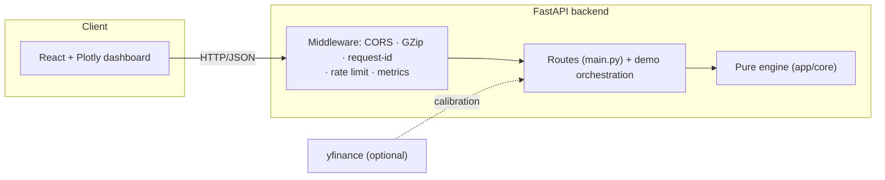
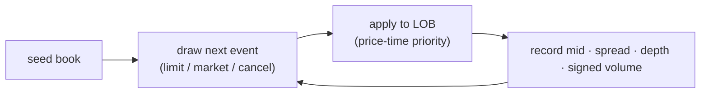

# Architecture

This document explains how the Market Microstructure Simulator is built: the
agent-based limit-order-book engine, the Poisson/Hawkes order-flow generators,
the discrete-event kernel, the stylized-fact metrics, and the new Hawkes
maximum-likelihood calibration.

> For *what* it does and how to run it, see the [README](../README.md); for the
> emergent stylized facts and their derivations, see
> [STYLIZED_FACTS.md](STYLIZED_FACTS.md). This document is the *how and why*.

---

## 1. Design goals

1. **A pure simulation engine.** Everything lives in `app/core/` as plain NumPy
   modules with **no FastAPI and no I/O**; the API, dashboard, and tests all call
   the same functions.
2. **Emergent, not scripted.** Fat-tailed returns, volatility clustering, a
   fluctuating spread, and price impact are *emergent* consequences of simple
   order-flow rules and price-time-priority matching — not hard-coded.
3. **Reproducible.** Every run is seeded; the same `SimConfig` and seed produce
   the same tape, so stylized facts and calibrations are deterministic.

---

## 2. System overview



`app/core` never imports the API layer; routes validate with Pydantic and
delegate to the engine.

---

## 3. The limit-order book

`LimitOrderBook` (`core/book.py`) maintains resting bids and asks under strict
**price-time priority**: better prices match first, and within a price level the
oldest order matches first (FIFO). It supports `limit`, `market`, and `cancel`,
and exposes best bid/ask, the mid, the spread, per-side depth, and a depth
snapshot — the observables the metrics and dashboard consume.

---

## 4. Order flow

Order flow is generated as competing streams that map onto maker / taker / noise
agent populations:

- **Poisson** (`flow/poisson.py`) — independent exponential inter-arrival times
  for limit orders (makers), market orders (takers), and cancellations.
- **Hawkes** (`flow/hawkes.py`) — a **self-exciting** point process for taker
  flow: each event transiently raises the intensity,

  $$ \lambda(t) = \mu + \sum_{t_i < t} \alpha\, e^{-\beta (t - t_i)} $$

  so trades cluster in time and **volatility clustering** emerges. The
  **branching ratio** `n = α/β ∈ [0, 1)` measures endogeneity (the share of
  events triggered by other events vs. exogenous arrivals); `n → 1` is the
  near-critical, reflexive regime. Simulation uses Ogata thinning.

Limit prices are placed at a geometric tick offset from the touch; sizes are
exponential — both seeded.

---

## 5. The discrete-event kernel

`MarketSimulator` (`core/simulator.py`) seeds a book, then for each event draws
the next action from the (optionally Hawkes-modulated) flow rates, applies it to
the book, and records the mid, spread, depth, and signed market volume. Fully
event-driven, so the tape is causal and reproducible.



---

## 6. Microstructure metrics & impact

- **Stylized facts** (`core/metrics.py`) — excess **kurtosis** (fat tails), the
  return ACF (near-zero, no linear predictability), the `|return|` ACF (slow
  decay = volatility clustering), the **Hurst** exponent, and realized
  volatility.
- **Price impact** (`core/impact.py`) — **Kyle's lambda** (regression of price
  change on signed volume) and the empirical **square-root** impact curve.

---

## 7. Agents

- **Avellaneda–Stoikov** (`core/agents.py`) — an inventory-skewed market maker
  that quotes a reservation price shifted by inventory risk and an
  optimal half-spread (`/api/agent/quote`).
- **Multi-agent** (`core/multiagent.py`) — market-maker, informed, and noise
  traders interacting through the book, with exact per-agent P&L
  (`/api/demo/multi-agent`).

---

## 8. Hawkes calibration (MLE)

The headline analytic upgrade: an exact **maximum-likelihood** estimator for the
exponential Hawkes process (`flow/hawkes.py`).

- **`hawkes_log_likelihood(times, mu, alpha, beta, horizon)`** evaluates the
  exact log-likelihood using the **Ozaki (1979) recursion**
  `A_i = e^{-β(t_i - t_{i-1})}(1 + A_{i-1})`, so the excitation sum costs O(n),
  plus the closed-form compensator `μT + (α/β)Σ(1 - e^{-β(T - t_i)})`.
- **`fit_hawkes(times, horizon)`** maximises it over log-parameters (keeping
  `μ, α, β > 0`) and returns the estimates, the **branching ratio**, the
  maximised log-likelihood, and convergence info.

This turns the old "crude" branching-ratio heuristic into a real calibration.
`GET /api/demo/hawkes-calibration` is a self-consistency demo — simulate with
known `(μ, α, β)`, then MLE-recover them — and `POST /api/hawkes/fit` calibrates
to user-supplied event times (e.g. real trade timestamps).

---

## 9. API & operations

Routes (`main.py`) stay thin; orchestration is in `demo.py`. Cross-cutting
concerns live in `observability.py` / `config.py`:

- **Observability** — `GET /api/version`, `/api/ready`, Prometheus `/metrics`;
  request-id + latency + security headers; structured logs.
- **Resilience** — GZip, CORS, an optional per-IP rate limiter, a global error
  envelope.
- **Config** — environment-driven (`CORS_ORIGINS`, `LOG_LEVEL`,
  `RATE_LIMIT_PER_SEC`).

---

## 10. Module map

```
backend/app/
  core/
    book.py           # price-time-priority limit-order book
    orders.py         # order / fill value types
    flow/
      poisson.py      # independent Poisson streams
      hawkes.py       # self-exciting flow + log-likelihood + fit_hawkes (MLE)
    simulator.py      # discrete-event kernel (SimConfig -> SimResult)
    scenarios.py      # balanced / thin_liquidity / toxic_flow presets
    metrics.py        # stylized facts, Hurst, realized vol
    impact.py         # Kyle lambda + square-root impact
    agents.py         # Avellaneda-Stoikov market maker
    multiagent.py     # MM / informed / noise multi-agent sim + PnL
  schemas.py          # Pydantic request models
  demo.py             # orchestration (canned scenarios + Hawkes demo)
  main.py             # FastAPI app + routes
  observability.py    # middleware, metrics, rate limiter
  config.py           # env-driven settings
  static/             # Plotly dashboard
frontend/             # React + Vite + TypeScript
scripts/bench.py      # engine + calibration throughput benchmark
```

**Dependency rule:** `api/demo → core`; `core` never imports the API layer.

---

## 11. Testing strategy

- **Matching** — price-time priority, partial fills, and cancels on hand-built
  books.
- **Reproducibility** — a fixed seed reproduces the tape bit-for-bit.
- **Stylized facts** — fat tails (positive excess kurtosis) and `|return|` ACF
  decay emerge from Hawkes flow.
- **Hawkes MLE** — the estimator recovers known `(μ, α, β)` from simulated events
  within finite-sample tolerance, the log-likelihood is higher at the truth than
  far away, and the branching ratio stays in `[0, 1)`.
- **API** — every endpoint via FastAPI's `TestClient`.

CI (GitHub Actions) runs ruff + pytest (coverage) on the backend, a type-checked
Vite build on the frontend, and validates the compose file.
